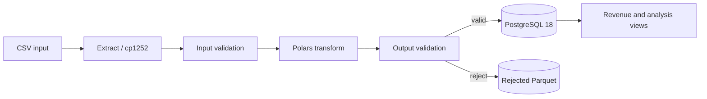

# ecommerce-pipeline

[](https://github.com/flint/ecommerce-pipeline/actions/workflows/ci.yml)

A local Python ETL pipeline that reads e-commerce transaction CSV files, validates and transforms rows with Polars, writes rejected rows to Parquet, and loads accepted rows into PostgreSQL. It is designed for one input file at a time and is validated with unit and integration tests.



## Sample data

`transactions_sample.csv` is a small, synthetic stand-in for the real transactions file. It lets you run the whole pipeline in seconds without downloading the full dataset, and it contains at least one example of every situation the pipeline handles: good rows, returns, non-product lines, stock adjustments, and rows that must be rejected.

> **Synthetic data.** It is modelled on this [E-Commerce Data](https://www.kaggle.com/datasets/carrie1/ecommerce-data)

## Quickstart

```bash
cp .env.example .env
docker compose up -d --wait
uv sync
uv run pipeline --path data/sample/transactions_sample.csv
```

On Windows PowerShell, the `cp` command is available and the forward-slash path is accepted. The sample run prints a summary with `49` read, `8` rejected, `0` skipped, and `41` loaded on a fresh database.

| pipeline     | read | rejected | skipped | loaded |
| ------------ | ---- | -------- | ------- | ------ |
| transactions | 49   | 8        | 0       | 41     |

## File facts

|              |                                                                                            |
| ------------ | ------------------------------------------------------------------------------------------ |
| Rows         | 49 data rows plus a header                                                                 |
| Columns      | `InvoiceNo, StockCode, Description, Quantity, InvoiceDate, UnitPrice, CustomerID, Country` |
| Encoding     | **cp1252**                                                                                 |
| Dates        | `M/D/YYYY H:MM`, for example `12/1/2010 8:26`                                              |
| Line endings | `\n`                                                                                       |
| Row numbers  | The pipeline numbers data rows 1 to 49 (`_source_row_number`), header excluded             |

## File content

| Rows  | Group             | What it exercises                                                                                                                                                      |
| ----- | ----------------- | ---------------------------------------------------------------------------------------------------------------------------------------------------------------------- |
| 1-22  | Product sales     | 5-digit catalog codes, 5 countries, 2 months, one anonymous customer (rows 17-18), one description with messy whitespace (row 22) that the transform cleans            |
| 23-24 | Returns           | `C`-prefixed invoices with a negative quantity and a real price, so they appear in `cancellations`                                                                     |
| 25-33 | Non-product lines | `POST`, `DOT`, `C2`, `M`, `D`, `BANK CHARGES`, `AMAZONFEE`, and a gift voucher (`gift_0001_20`) whose description contains the corrupted pound sign                    |
| 34-40 | Stock adjustments | Catalog code, price 0, no customer: `?`, `damaged`, `found`, an empty description, `adjustment`, and `"Unsaleable, destroyed."` (a quoted field that contains a comma) |
| 41    | Free item         | Catalog code and price 0, but **with** a customer: a shipped free item, not an adjustment                                                                              |
| 42-49 | Bad rows          | One per reject reason (see below), including one row with two reasons                                                                                                  |

The corrupted pound sign is deliberate. The file contains the bytes `EF BF BD`, which decode as `�` under cp1252, and the transform repairs them to `£`.

## Expected results

### First run

| read | rejected | skipped | loaded |
| ---- | -------- | ------- | ------ |
| 49   | 8        | 0       | 41     |

### Rejected rows

Saved as Parquet under `<rejected dir>/transactions/`.

| Source row | Invoice   | Stage  | `_reject_reason`                     |
| ---------- | --------- | ------ | ------------------------------------ |
| 42         | `A563186` | output | `negative_unit_price`                |
| 43         | `540200`  | output | `unparseable_unit_price`             |
| 44         | _(blank)_ | input  | `missing_invoice_no`                 |
| 45         | `540201`  | output | `unparseable_invoice_date`           |
| 46         | `540202`  | output | `zero_quantity`                      |
| 47         | `540203`  | output | `unparseable_quantity`               |
| 48         | `540204`  | input  | `missing_country`                    |
| 49         | _(blank)_ | input  | `missing_invoice_no;missing_country` |

### The 41 loaded rows

| Kind              | Rows | Counted as a sale?                            |
| ----------------- | ---- | --------------------------------------------- |
| Product sales     | 22   | Yes                                           |
| Returns           | 2    | No, they appear in `cancellations` instead    |
| Non-product lines | 9    | No (stock code is not a 5-digit catalog code) |
| Stock adjustments | 7    | No (price 0, no customer)                     |
| Free item         | 1    | No (price 0)                                  |

### Checks in Postgres

```sql
SELECT count(*) FROM transactions;                            -- 41

SELECT count(*) FROM transactions WHERE _is_product;          -- 24 (22 sales + 2 returns)

SELECT count(*) FROM cancellations;                           -- 2

SELECT ROUND(SUM(revenue), 2) FROM daily_revenue;             -- 566.11

SELECT SUM(order_count) FROM daily_revenue;                   -- 13

SELECT count(*) FROM revenue_by_country;                      -- 5 countries

SELECT count(*)
FROM transactions
WHERE stock_code ~ '^[0-9]{5}'
      AND unit_price = 0
      AND customer_id IS NULL;                                -- 7 stock adjustments

SELECT description
FROM transactions
WHERE stock_code = 'gift_0001_20';                            -- Dotcomgiftshop Gift Voucher £20.00

SELECT description
FROM transactions
WHERE stock_code = '71053'
      AND invoice_no = '540004';                              -- WHITE METAL LANTERN (whitespace cleaned)
```

### Second run

Running the same command again is skipped, because the file hash is already recorded:

| read | rejected | skipped | loaded |
| ---- | -------- | ------- | ------ |
| 49   | 8        | 41      | 0      |

`transactions` still holds 41 rows, and `loaded_files` still holds one row.

## Views

The pipeline creates these SQL views:

- `file_load_history`
- `cancellations`
- `daily_revenue`
- `monthly_revenue`
- `non_product_summary`
- `revenue_by_country`
- `rfm`
- `stock_adjustments`

## Testing

Run the complete test suite with:

```bash
uv run pytest
```

- Unit tests cover CSV extraction, Polars transformations, and validation rules.
- Integration tests cover PostgreSQL loading, idempotency, the CLI entry point, and views.
- Integration tests use `DB_NAME_TEST`, reset the public schema, and reject any connection whose database name does not contain `test`.

The test suite writes temporary rejected files and does not modify `data/rejected/`.

## Real dataset

The full source file belongs at `data/raw/transactions.csv`. It is expected to use **cp1252** encoding and can be run with:

```bash
uv run pipeline --path data/raw/transactions.csv
```

The raw file is intentionally not committed to this repository.

## Limitations

- Supports one transaction CSV layout and one file type.
- Loads are rerun only when a file hash has not been recorded; there is no incremental merge or change feed.
- There is no scheduling or external orchestration; runs are launched manually.
- The pipeline runs from a source clone. It is not packaged or installed as a complete wheel deployment.
- Processing is in-memory on one machine, with no distributed execution.

## Future work

- Add incremental load strategies and explicit handling for changed source files.
- Add orchestration and scheduling.
- Add more input formats or data sources behind a common extractor contract.
- Package deployment configuration and deployment automation.
- Expand reconciliation, data-quality reports, and observability.
